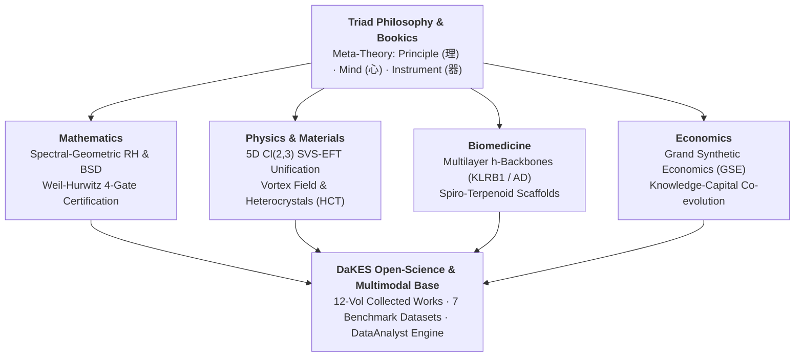

# DaKES Institute: Collected Monographs, Papers & Datasets of Prof. Dr. Fred Y. Ye

> **Official Holographic Knowledge Portal & Open-Science Repository**  
> **Author:** Prof. Dr. Fred Y. Ye (叶福翔) | DaKES Institute & Nanjing University  
> **Repository URL:** [https://github.com/fredyingye-usa/dakes](https://github.com/fredyingye-usa/dakes)  
> 💡 *Click the **⭐ Star** and **👁️ Watch** buttons at the top-right corner to bookmark this repository and receive updates.*

---

## 🌐 Holographic & Multimodal Knowledge Matrix (全息理论架构与 AI 交互门户)

* 🎧 **AI Deep-Dive Audio Overview & Interactive Assistant (Google Notebook):** [**Click here to listen to the AI-generated academic podcast & chat interactively**](https://notebooklm.link.google/KhplRaniV973) with all 12 volumes of *Collected Representative Works*, mathematical proofs, physical unifications, and biomedical datasets.
* 🧭 **Stereoscopic Architecture of the DaKES Theoretical System:**

---

## 1. Key Academic Monographs & Collected Works (学术专著与代表作全集)
| Date | Discipline | Monograph Title | Permanent Identifiers (Zenodo DOI & B&N Press ISBN) |
| :--- | :--- | :--- | :--- |
| 2026-11-01 | `Collected Works` | **Dr. Ye's Collected Representative Works (Total 12 Vols.)** |  |
| 2026-07-08 | `Mathematics` | **Spectral-Geometric Program of the Riemann and Grand Riemann Hypotheses** |   |
| 2026-07-08 | `Mathematics` | **Spectral-Flow and Geometric-Closure Framework for Hodge Classes: A Conditional Program** |   |
| 2026-06-26 | `Physics` | **Vortex Field Theory: New Principles for Approaching Physical Unification** |   |
| 2026-06-26 | `Physics` | **Scalar-Vector-Spinor Effective Field Theory: A 5D Cl(2,3) Physical Unification** |   |

---

## 2. Mathematical Papers (Riemann Hypothesis, Spectral Flow & Langlands)
| Date | Type | Title | Permanent Identifier (DOI) |
| :--- | :--- | :--- | :--- |
| 2026-04-24 | `Paper` | Reversal Dual Calculus: Harmonic Regularization in Gravitational Potential and Zeta Function Duality |  |
| 2026-06-27 | `Paper` | Spectral Flow and Categorified Index for Higher-Dimensional Prime-Torus Packets over the Scaling Site |  |
| 2026-06-27 | `Paper` | From Prime Circles to Fargues-Fontaine Curves: A Conditional Spectral-Flow Framework for Local Arithmetic Langlands |  |
| 2026-06-27 | `Paper` | Arithmetic Dirac Packets, Fargues-Fontaine Slopes, and Weil Positivity: A Conditional Spectral Route Toward the Riemann Hypothesis |  |
| 2026-06-28 | `Paper` | Operator Traces, Prime-Power Weights, and a Trace-Compatible Weil Positivity Theorem |  |
| 2026-06-28 | `Paper` | Uniform Convergence of Regularized Determinants for Zeta Spectral Triples: Toward Global Weil Positivity and the Riemann Hypothesis |  |
| 2026-06-28 | `Paper` | Screw Functions, de Branges Spaces, and Zeta Spectral Triples: A Spectral-Geometric Approach to RH and GRH |  |
| 2026-06-29 | `Paper` | Spectral-Geometric Approaches to RH and GRH: The Sobolev-Suzuki L² Framework for WEC and TR |  |
| 2026-07-08 | `Paper` | A Spectral-Geometric Program of Birch and Swinnerton-Dyer Conjecture |  |
| 2026-07-12 | `Paper` | Spectral Paradigm of Analytic Number Theory |  |
| 2026-11-02 | `Paper` | Quantitative Ground State Closure for the Weil Operator and Diagonal Hurwitz Reduction of the Riemann Hypothesis |  |
| 2026-11-02 | `Paper` | Two Decisive Closure Theorems for a Weil Hurwitz Approach to the Riemann Hypothesis |  |
| 2026-11-02 | `Paper` | Four Gate Certification for a Weil Hurwitz Route to the Riemann Hypothesis |  |

---

## 3. Physical Papers & Datasets (5D Cl(2,3) SVS-EFT, Vortex Field & Heterocrystals)
| Date | Type | Title | Permanent Identifier (DOI) |
| :--- | :--- | :--- | :--- |
| 2026-04-25 | `Paper` | TimeKK_Zenodo: A Modified Kaluza-Klein Framework for Quantum Gravity via Imaginary Time as a Fifth Dimension |  |
| 2026-04-25 | `Paper` | A Unified Operational Framework for Wave–Particle Duality via Metaplectic Transforms |  |
| 2026-04-28 | `Paper` | A Minimal Scalar-Vector-Spinor Effective Field Theory for Dark-Sector Phenomenology and Modified Cosmological Dynamics |  |
| 2026-05-01 | `Paper` | A 5D Scalar-Vector-Spinor Effective Field Theory in Cl(2,3): Real-Imaginary Time Co-ordering Energy-Information |  |
| 2026-05-02 | `Paper` | Metaplectic Holography and Gauge Embedding in 5D SVS-EFT: Bridging the Standard Model and Gravitation |  |
| 2026-08-19 | `Paper` | Theory of Heterocrystals: Unit-Cell Rupture, Emergent Gauge Fields, and Quantum Geometry |  |
| 2026-08-19 | `Paper` | Heterocrystalline chimeric technology: topology-gated multiphysics and risk-aware inverse design |  |
| 2026-07-30 | `Dataset` | Dataset: Theory of heterocrystals |  |
| 2026-08-03 | `Dataset` | Dataset: Heterocrystalline chimeric technology |  |
| 2026-10-22 | `Dataset` | Heterocrystalline chimeric technology -- completed dataset |  |

---

## 4. Biomedical Papers & Datasets (Multilayer h-Backbones & Spiro-Terpenoid Scaffolds)
| Date | Type | Title | Permanent Identifier (DOI) |
| :--- | :--- | :--- | :--- |
| 2026-05-08 | `Paper` | OCT4-MHC Tight Linkage in Mammals: A Comparative Evo-Devo, Immunogenomic, and Topological Framework |  |
| 2026-08-19 | `Paper` | Multilayer h-Backbones Identify KLRB1 as a Stable Immune-Ageing h-Focus across Populations, Tissues and Cell Lineages |  |
| 2026-08-22 | `Paper` | Multiscale h-Foci and CNS-Gated Reversal Identify Riluzole as a Repurposing Candidate in Alzheimer's Disease |  |
| 2026-08-28 | `Paper` | Spiro-Terpenoid Privileged Scaffolds: An Auditable Multiscale Workflow for Undruggable Targets |  |
| 2026-09-15 | `Paper` | Comparator-Dependent Druggability and Safety of Spiro-Terpenoid Scaffolds: A Proteome-Scale Pocket-Transfer Screen |  |
| 2026-07-21 | `Dataset` | Dataset: Multilayer h-Backbones Identify KLRB1 as a Stable Immune-Ageing h-Focus across Populations, Tissues and Cell Lineages |  |
| 2026-07-22 | `Dataset` | Dataset: Multiscale h-Foci and CNS-Gated Reversal Identify Riluzole as a Repurposing Candidate in Alzheimer's Disease |  |
| 2026-08-11 | `Dataset` | Dataset: Spiro-Terpenoid Privileged Scaffolds |  |
| 2026-08-17 | `Dataset` | Dataset: Comparator-Dependent Druggability and Safety of Spiro-Terpenoid Scaffolds |  |

---

## 5. Grand Synthetic Economics (GSE) & Triad Philosophy (SSRN Series)
| Date | Discipline | Title | Permanent Identifier (SSRN DOI) |
| :--- | :--- | :--- | :--- |
| 2026-05-02 | `Economics` | Market-Driven Growth with Knowledge and Capital as Twin Propellants: Integrating Melitz-Finance Micro-foundations and Ramsey Optimal Policy |  |
| 2026-05-03 | `Economics` | Probing the Efficiency-Equity-Innovation Trilemma: Economic Analysis via Grand Synthetic Model |  |
| 2026-05-04 | `Economics` | Knowledge-Driven Endogenous Growth in Open Economy: A Grand Synthetic Approach |  |
| 2026-09-08 | `Economics` | Knowledge and Capital as Co-evolving Productive Stocks: A Minimal Core of Grand Synthetic Economics |  |
| 2026-09-08 | `Economics` | Creative Destruction and Open-Market Reversals: Dynamic Equilibrium in Grand Synthetic Economics |  |
| 2026-05-12 | `Philosophy` | AI Philosophy from Triad Philosophy: Triadic Governance of Artificial Intelligence beyond Binary Minds |  |

---

## 6. Plain-Text Chronological Archive (原始文本档案列表)

<b>Click to expand / collapse the plain-text publication list (点击展开/收起纯文本列表)</b>

### Academic monograph
* **2026-11-1: Dr. Ye's Collected Representative Works (Total 12 Vols.)**  
  DOI: `10.5281/zenodo.23886305` | URL: https://zenodo.org/records/23886305

### Mathematical monographs
* **2026-7-8: Spectral-Geometric Program of the Riemann and Grand Riemann Hypotheses.** B&N Press ISBN: `979-8-182-51852-9`  
  DOI: `10.5281/zenodo.22060151` | URL: https://zenodo.org/records/22060151
* **2026-7-8: Spectral-Flow and Geometric-Closure Framework for Hodge Classes: A Conditional Program.** B&N Press ISBN: `979-8-182-51854-3`  
  DOI: `10.5281/zenodo.22770350` | URL: https://zenodo.org/records/22770350

### Physical monographs
* **2026-6-26: Vortex Field Theory: New Principles for Approaching Physical Unification.** B&N Press ISBN: `979-8-823-18069-6`  
  DOI: `10.5281/zenodo.23675225` | URL: https://zenodo.org/records/23675225
* **2026-6-26: Scalar-Vector-Spinor Effective Field Theory: A 5D Cl(2,3) Physical Unification.** B&N Press ISBN: `979-8-182-50531-4`  
  DOI: `10.5281/zenodo.23675315` | URL: https://zenodo.org/records/23675315

### Mathematical papers
* **2026-4-24:** Reversal Dual Calculus: Harmonic Regularization in Gravitational Potential and Zeta Function Duality — DOI: `10.5281/zenodo.19764503` | URL: https://zenodo.org/records/19764503
* **2026-6-27:** Spectral Flow and Categorified Index for Higher-Dimensional Prime-Torus Packets over the Scaling Site — DOI: `10.5281/zenodo.20944516` | URL: https://zenodo.org/records/20944516
* **2026-6-27:** From Prime Circles to Fargues-Fontaine Curves: A Conditional Spectral-Flow Framework for Local Arithmetic Langlands — DOI: `10.5281/zenodo.20944785` | URL: https://zenodo.org/records/20944785
* **2026-6-27:** Arithmetic Dirac Packets, Fargues-Fontaine Slopes, and Weil Positivity: A Conditional Spectral Route Toward the Riemann Hypothesis — DOI: `10.5281/zenodo.20945167` | URL: https://zenodo.org/records/20945167
* **2026-6-28:** Operator Traces, Prime-Power Weights, and a Trace-Compatible Weil Positivity Theorem — DOI: `10.5281/zenodo.20997606` | URL: https://zenodo.org/records/20997606
* **2026-6-28:** Uniform Convergence of Regularized Determinants for Zeta Spectral Triples: Toward Global Weil Positivity and the Riemann Hypothesis — DOI: `10.5281/zenodo.20998327` | URL: https://zenodo.org/records/20998327
* **2026-6-28:** Screw Functions, de Branges Spaces, and Zeta Spectral Triples: A Spectral-Geometric Approach to RH and GRH — DOI: `10.5281/zenodo.20998512` | URL: https://zenodo.org/records/20998512
* **2026-6-29:** Spectral-Geometric Approaches to RH and GRH: The Sobolev-Suzuki L² Framework for WEC and TR — DOI: `10.5281/zenodo.21032614` | URL: https://zenodo.org/records/21032614
* **2026-7-8:** A Spectral-Geometric Program of Birch and Swinnerton-Dyer Conjecture — DOI: `10.5281/zenodo.21316732` | URL: https://zenodo.org/records/21316732
* **2026-7-12:** Spectral Paradigm of Analytic Number Theory — DOI: `10.5281/zenodo.23126332` | URL: https://zenodo.org/records/23126332
* **2026-11-2:** Quantitative Ground State Closure for the Weil Operator and Diagonal Hurwitz Reduction of the Riemann Hypothesis — DOI: `10.5281/zenodo.23886960` | URL: https://zenodo.org/records/23886960
* **2026-11-2:** Two Decisive Closure Theorems for a Weil Hurwitz Approach to the Riemann Hypothesis — DOI: `10.5281/zenodo.23887241` | URL: https://zenodo.org/records/23887241
* **2026-11-2:** Four Gate Certification for a Weil Hurwitz Route to the Riemann Hypothesis — DOI: `10.5281/zenodo.23887551` | URL: https://zenodo.org/records/23887551

### Physical papers & datasets
* **2026-4-25:** TimeKK_Zenodo: A Modified Kaluza-Klein Framework for Quantum Gravity via Imaginary Time as a Fifth Dimension — DOI: `10.5281/zenodo.19764139` | URL: https://zenodo.org/records/19764139
* **2026-4-25:** A Unified Operational Framework for Wave–Particle Duality via Metaplectic Transforms — DOI: `10.5281/zenodo.19772394` | URL: https://zenodo.org/records/19772394
* **2026-4-28:** A Minimal Scalar-Vector-Spinor Effective Field Theory for Dark-Sector Phenomenology and Modified Cosmological Dynamics — DOI: `10.5281/zenodo.19855576` | URL: https://zenodo.org/records/19855576
* **2026-5-1:** A 5D Scalar-Vector-Spinor Effective Field Theory in Cl(2,3): Real-Imaginary Time Co-ordering Energy-Information — DOI: `10.5281/zenodo.19949736` | URL: https://zenodo.org/records/19949736
* **2026-5-2:** Metaplectic Holography and Gauge Embedding in 5D SVS-EFT: Bridging the Standard Model and Gravitation — DOI: `10.5281/zenodo.19981083` | URL: https://zenodo.org/records/19981083
* **2026-8-19:** Theory of Heterocrystals: Unit-Cell Rupture, Emergent Gauge Fields, and Quantum Geometry — DOI: `10.5281/zenodo.22017051` | URL: https://zenodo.org/records/22017051
* **2026-8-19:** Heterocrystalline chimeric technology: topology-gated multiphysics and risk-aware inverse design — DOI: `10.5281/zenodo.22017089` | URL: https://zenodo.org/records/22017089
* **2026-7-30:** Dataset: Theory of heterocrystals — DOI: `10.5281/zenodo.21702944` | URL: https://zenodo.org/records/21702944
* **2026-8-3:** Dataset: Heterocrystalline chimeric technology — DOI: `10.5281/zenodo.21778647` | URL: https://zenodo.org/records/21778647
* **2026-10-22:** Heterocrystalline chimeric technology -- completed dataset — DOI: `10.5281/zenodo.23575685` | URL: https://zenodo.org/records/23575685

### Biomedical papers & datasets
* **2026-5-8:** OCT4-MHC Tight Linkage in Mammals: A Comparative Evo-Devo, Immunogenomic, and Topological Framework — DOI: `10.5281/zenodo.20089673` | URL: https://zenodo.org/records/20089673
* **2026-8-19:** Multilayer h-Backbones Identify KLRB1 as a Stable Immune-Ageing h-Focus across Populations, Tissues and Cell Lineages — DOI: `10.5281/zenodo.22018570` | URL: https://zenodo.org/records/22018570
* **2026-8-22:** Multiscale h-Foci and CNS-Gated Reversal Identify Riluzole as a Repurposing Candidate in Alzheimer's Disease — DOI: `10.5281/zenodo.22057218` | URL: https://zenodo.org/records/22057218
* **2026-8-28:** Spiro-Terpenoid Privileged Scaffolds: An Auditable Multiscale Workflow for Undruggable Targets — DOI: `10.5281/zenodo.22147096` | URL: https://zenodo.org/records/22147096
* **2026-9-15:** Comparator-Dependent Druggability and Safety of Spiro-Terpenoid Scaffolds: A Proteome-Scale Pocket-Transfer Screen — DOI: `10.5281/zenodo.22770001` | URL: https://zenodo.org/records/22770001
* **2026-7-21:** Dataset: Multilayer h-Backbones Identify KLRB1 as a Stable Immune-Ageing h-Focus across Populations, Tissues and Cell Lineages — DOI: `10.5281/zenodo.21464228` | URL: https://zenodo.org/records/21464228
* **2026-7-22:** Dataset: Multiscale h-Foci and CNS-Gated Reversal Identify Riluzole as a Repurposing Candidate in Alzheimer's Disease — DOI: `10.5281/zenodo.21493971` | URL: https://zenodo.org/records/21493971
* **2026-8-11:** Dataset: Spiro-Terpenoid Privileged Scaffolds — DOI: `10.5281/zenodo.21888841` | URL: https://zenodo.org/records/21888841
* **2026-8-17:** Dataset: Comparator-Dependent Druggability and Safety of Spiro-Terpenoid Scaffolds — DOI: `10.5281/zenodo.21970731` | URL: https://zenodo.org/records/21970731

### Economic & Philosophical papers (SSRN)
* **2026-5-2:** Market-Driven Growth with Knowledge and Capital as Twin Propellants: Integrating Melitz-Finance Micro-foundations and Ramsey Optimal Policy — DOI: `10.2139/ssrn.6697998` | URL: https://ssrn.com/abstract=6697998
* **2026-5-3:** Probing the Efficiency-Equity-Innovation Trilemma: Economic Analysis via Grand Synthetic Model — DOI: `10.2139/ssrn.6703820` | URL: https://ssrn.com/abstract=6703820
* **2026-5-4:** Knowledge-Driven Endogenous Growth in Open Economy: A Grand Synthetic Approach — DOI: `10.2139/ssrn.6709739` | URL: https://ssrn.com/abstract=6709739
* **2026-9-8:** Knowledge and Capital as Co-evolving Productive Stocks: A Minimal Core of Grand Synthetic Economics — DOI: `10.2139/ssrn.7473120` | URL: https://ssrn.com/abstract=7473120
* **2026-9-8:** Creative Destruction and Open-Market Reversals: Dynamic Equilibrium in Grand Synthetic Economics — DOI: `10.2139/ssrn.7473121` | URL: https://ssrn.com/abstract=7473121
* **2026-5-12:** AI Philosophy from Triad Philosophy: Triadic Governance of Artificial Intelligence beyond Binary Minds — DOI: `10.2139/ssrn.6755681` | URL: https://ssrn.com/abstract=6755681

---

## 7. Citation & Licensing
* **Citation:** All BibTeX entries are consolidated in [`references.bib`](references.bib). You can also click the **"Cite this repository"** button on the top-right sidebar of this GitHub page.
* **License:** All texts, monographs, and datasets are licensed under [Creative Commons Attribution 4.0 International (CC BY 4.0)](https://creativecommons.org/licenses/by/4.0/).
